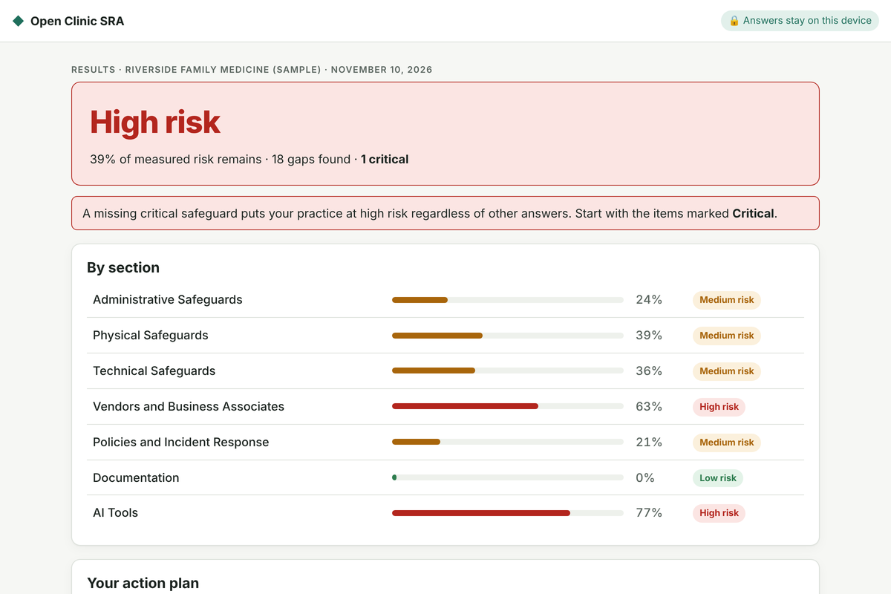
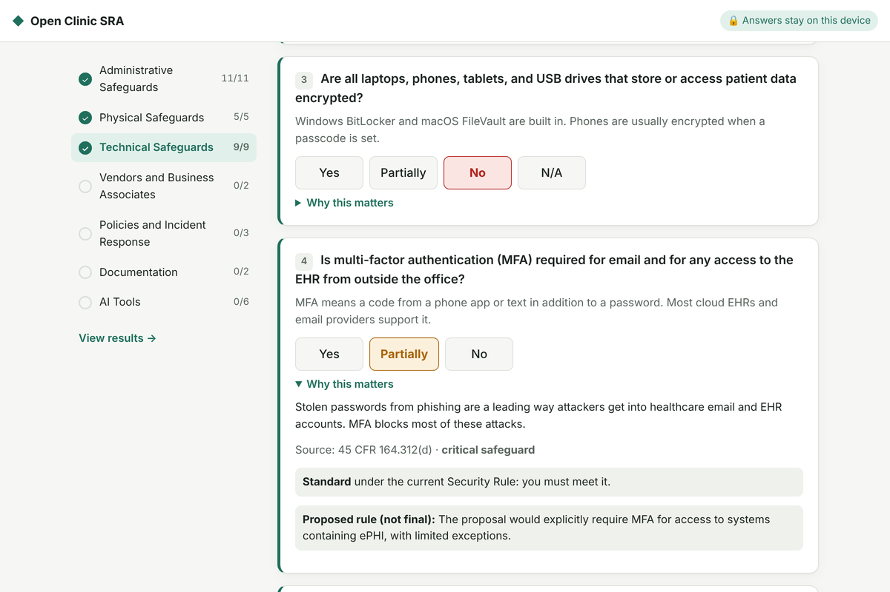

# Open Clinic SRA

**A free HIPAA Security Risk Assessment built for small and rural medical practices.**

Answer 38 plain-language questions in about 20–25 minutes. Get a risk rating,
a prioritized action plan, and a signed report you can keep with your HIPAA
records. No account, no cost, and your answers never leave your computer.

### 👉 [Start your assessment](https://chisom303.github.io/open-clinic-sra/) · [See a sample report (PDF)](docs/sample-report.pdf)

[](https://github.com/Chisom303/open-clinic-sra/actions/workflows/ci.yml)
[](LICENSE)

[](https://doi.org/10.5281/zenodo.24206639)

> ⚠️ **Not legal advice and not a compliance certification.** This is a
> structured self-assessment to support your practice's own risk analysis.
> See [DISCLAIMER.md](DISCLAIMER.md).



---

## Who this is for

- **Small practices** with 1–10 providers: family medicine, dental,
  chiropractic, physical therapy, behavioral health, and similar clinics.
- **Rural and independent practices** without a dedicated IT or compliance
  team, where a consultant-led risk analysis is out of reach.
- **IT providers and consultants** who support small practices and want a
  free, transparent tool to run assessments with their clients.

## Why it matters

Every practice that handles electronic patient information must perform an
accurate and thorough **security risk analysis**
([45 CFR 164.308(a)(1)(ii)(A)](https://www.ecfr.gov/current/title-45/subtitle-A/subchapter-C/part-164/subpart-C/section-164.308)).
A missing or outdated risk analysis is one of the findings most often cited in
HHS enforcement actions. Many small practices don't have one, because most
options are either expensive or hard to use without an IT background.

## What you get

| | |
|---|---|
| **38 plain-language questions** | Written for a practice manager, not a security engineer. Each one explains what it means and why it matters. |
| **A risk rating** | Low, Medium or High overall and for each area, based on how likely and how harmful each gap is. |
| **A prioritized action plan** | Every gap comes with how to fix it and a suggested deadline. The most serious gaps come first. |
| **A signed report** | Cover page, method, results, risk management plan, and attestation with signature lines. Print it or save it as a PDF. |
| **Next year, update instead of restart** | Save your assessment as a file and load it next year to update it. |
| **Free resources** | Links to free help from HHS and CISA for small practices. |

### What it covers

| Area | Examples |
|---|---|
| Administrative safeguards | Risk analysis, Security Officer, training, backups, staff offboarding |
| Physical safeguards | Locked areas, screen privacy, device disposal, device inventory |
| Technical safeguards | Unique logins, encryption, multi-factor authentication, patching, Wi-Fi |
| Vendors and business associates | Business Associate Agreements with every vendor |
| Policies and incident response | Incident response plan, breach notification |
| Documentation | Written policies, 6-year record retention |
| **AI tools** | AI scribes and coding tools, AI vendor agreements, staff use of public chatbots |



## How to use it

1. Open **https://chisom303.github.io/open-clinic-sra/** in any modern browser
   (Chrome, Edge, Safari or Firefox) on a computer or tablet.
2. Enter your practice name and start. Answer honestly; **Partially** and
   **N/A** are available where they make sense.
3. Review your results and action plan.
4. Click **Open signed report**, then **Print or save as PDF**. Sign it and
   store it with your HIPAA records for at least 6 years.
5. Click **Save to file** so you can load and update it next year.

You can stop at any time. Answers are saved in your browser, so you can come
back later on the same computer.

## Privacy

- **Your answers never leave your browser.** The tool has no server and no
  account. Answers are stored only on your device, and reports are printed or
  saved as PDF on your own computer.
- **Never enter patient information.** The tool asks about safeguards only.
- **Anonymous usage counts.** To see how many practices use the tool, the site
  counts visits and a few steps (assessment started, completed, report printed,
  file saved or loaded, feedback clicked) using
  [GoatCounter](https://www.goatcounter.com), which does not use cookies or
  track individuals. Only fixed page and event names are sent, never answers,
  practice names, or anything you type. The allow-list is in
  [`src/app/analytics.js`](src/app/analytics.js) and enforced by tests. Like any
  website, the counter's server briefly receives your browser's network address
  when it loads. Content blockers that block GoatCounter don't affect the tool.

## How scoring works

Each safeguard is weighted by **likelihood × impact**, a method consistent with
NIST SP 800-30. Missing **critical** safeguards (risk analysis, tested backups,
device encryption, multi-factor authentication, Business Associate Agreements,
and an incident response plan) raise the overall rating to at least High.
Every question cites the regulation or official guidance it comes from.

Full details: [docs/methodology.md](docs/methodology.md).

### About the proposed HIPAA Security Rule update

HHS proposed major changes to the Security Rule in January 2025, including
required multi-factor authentication and encryption. **That rule is not final.**
The tool scores against the rule currently in force and flags questions the
proposal would affect, so practices can prepare without over-investing in
requirements that may still change.

## How this compares to the official HHS SRA Tool

HHS and ONC offer a free [Security Risk Assessment Tool](https://www.healthit.gov/topic/privacy-security-and-hipaa/security-risk-assessment-tool)
for small and medium practices. It is more detailed, and we encourage practices
to look at it. Open Clinic SRA is not affiliated with HHS. It aims to be a
faster, plain-language starting point: it runs in a browser with nothing to
install, produces a prioritized fix-it plan and a signed report, covers AI
tools, and is open source so anyone can review or improve it.

## For IT providers and consultants

- Run the assessment with a client, then save the file and the signed report
  to their records.
- Mark yourself as **an outside consultant** on the start page; it appears on
  the report.
- The tool is MIT-licensed. You may use it with clients, including as part of
  paid services. Contributions that improve accuracy are very welcome.

## Feedback and help

- **Did it help?** Use the **Share feedback** button on the results page, or
  [open a feedback form](https://github.com/Chisom303/open-clinic-sra/issues/new?template=feedback.yml).
  Please don't include patient information or details of specific security
  weaknesses; GitHub issues are public.
- **Found a wrong citation or unclear question?** See
  [CONTRIBUTING.md](CONTRIBUTING.md). No coding needed.
- **Security issue in the tool?** See [SECURITY.md](SECURITY.md).

## Project status

**Version 1.0.** The assessment, scoring, and report are complete and tested.
The question bank is awaiting independent review by compliance professionals,
and updates from that review will be released as new versions. Planned next:

- [ ] Independent expert review of all questions and weights
- [ ] ePHI asset inventory section
- [ ] More questions toward full Security Rule coverage
- [ ] Spanish translation

If you are a HIPAA compliance professional, attorney, or auditor and are
willing to review the question bank, please
[get in touch](mailto:Aloziechisom23@gmail.com) or open an issue.

## How to cite

If you use or refer to Open Clinic SRA in research, training, or publications,
please cite it. Click **Cite this repository** on the right side of the GitHub
page for APA and BibTeX formats, or use:

> Alozie, C. (2026). *Open Clinic SRA: A free, open-source HIPAA Security Risk
> Assessment for small and rural medical practices* (Version 1.0.0) [Computer
> software]. Zenodo. https://doi.org/10.5281/zenodo.24206639

Citation details are kept in [CITATION.cff](CITATION.cff).

## About the maintainer

**Chisom Alozie** is an enterprise IT and cybersecurity practitioner and
researcher. She spent her first nine years in IT support and engineering, and
the last eight in cybersecurity and AI/ML consulting and research. She has
published more than 40 academic papers, most of them on using machine learning
and automation to detect threats and help organizations recover from attacks.

She started Open Clinic SRA because small practices are held to the same HIPAA
security rules as large hospitals, usually without an IT team or a compliance
budget. A good risk assessment should not depend on the size of the practice.

GitHub: [@Chisom303](https://github.com/Chisom303)

---

## For developers

Requires Node.js 20+.

```bash
npm install
npm run dev        # run the app locally at http://localhost:5173
npm run validate   # check every question against the schema
npm test           # run the tests
npm run build      # build the static site into dist/
```

```
content/
  sections.yaml        # assessment sections, in display order
  questions/*.yaml     # one file per section
  schema.json          # JSON Schema every question must satisfy
src/
  scoring.mjs          # scoring engine (pure functions, no I/O)
  app/                 # browser app: screens, styles, local-only storage, analytics allow-list
scripts/
  validate.mjs         # validates all content against the schema
test/                  # scoring, import, and analytics tests
docs/
  methodology.md       # how risk is calculated, in plain language
  sample-report.pdf    # sample report for a fictional practice
```

The app deploys to GitHub Pages automatically on every push to `main`
(**Settings → Pages → Source: GitHub Actions**).

## License

- Code: [MIT](LICENSE)
- Question bank and documentation (`content/`, `docs/`): [CC BY 4.0](LICENSE-CONTENT)
